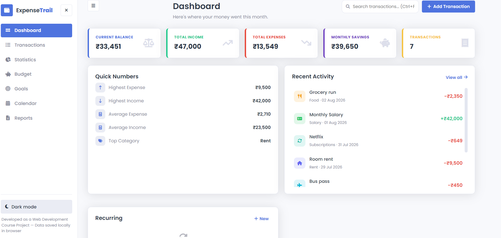
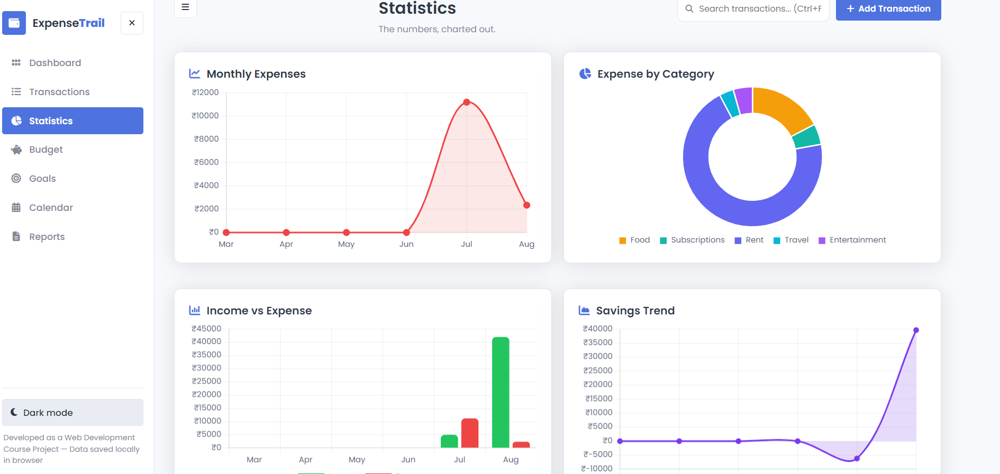
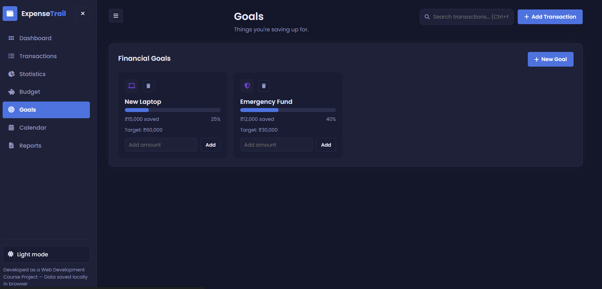
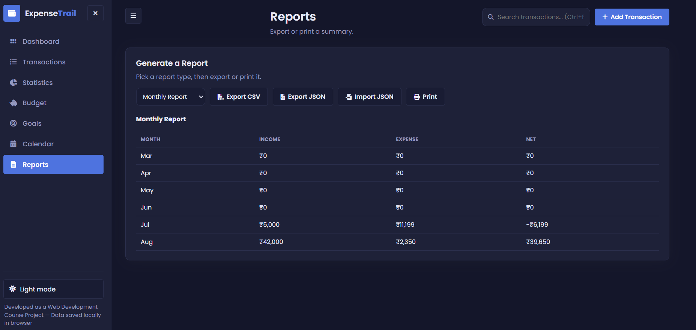
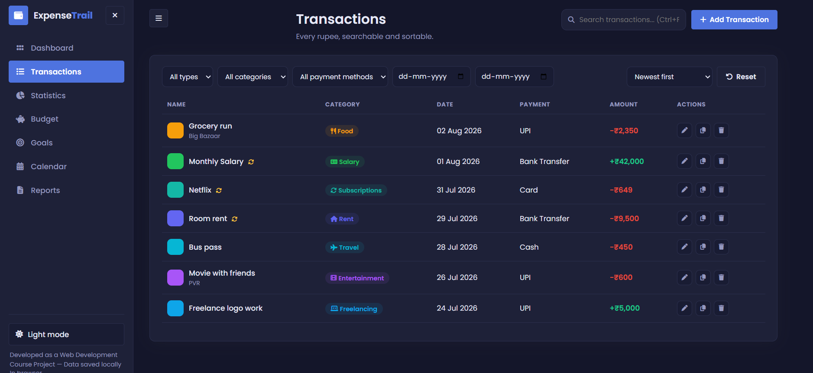
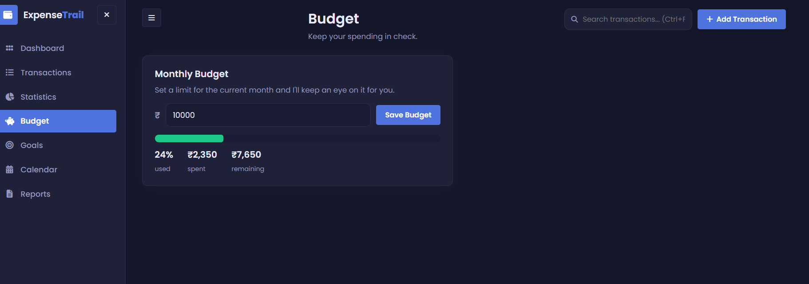

# ExpenseTrail 💸

A personal expense tracker I built to actually keep tabs on my own spending (broke-college-student energy). No backend, no sign-up — everything lives in your browser's local storage, so it's private and works offline once the page has loaded once.

I originally built this for a web dev course project, then kept adding to it because it turned out kind of useful. It's not perfect and there are a couple of "good enough for now" decisions in the code, but it's fully functional and I use it myself.
 
> **Live demo:** just open `index.html`, no build step needed.

---

## Screenshots

**Dashboard**



**Statistic** 

 

**DarkMode**



**Report**

 

**Transaction**



**Budget**




---

## Features

**Dashboard**
- Current balance, total income, total expenses, monthly savings, transaction count — as animated stat cards
- Quick numbers panel: highest expense/income, averages, top spending category
- Recent activity (last 10 transactions)
- Recurring transactions panel
- Income vs. expense mini chart

**Add / edit transactions**
- Income or expense toggle
- Name, amount, category, date, payment method, notes
- Mark as recurring (auto re-adds itself each month on the same day)
- Proper validation — no empty name, amount has to be > 0, date can't be nonsense

**Transaction history**
- Search by name, category, amount, or date
- Filter by type, category, payment method, and date range
- Sort: newest, oldest, highest, lowest, alphabetical
- Pagination
- Edit, duplicate, and delete (with a confirm step) on every row

**Statistics**
- Monthly Expenses — line chart
- Expense by Category — doughnut chart
- Income vs Expense — bar chart
- Savings Trend — area-style line chart
- All powered by Chart.js and update automatically when your data changes

**Budget planner**
- Set a monthly limit
- See amount spent, remaining, and percentage used
- Visual warning banner if you go over

**Goals**
- Create savings goals (laptop, trip, emergency fund, whatever)
- Add money toward them and watch the progress bar fill up

**Calendar view**
- Month grid, click any day to see what happened that day

**Reports**
- Monthly / yearly / category / summary report views
- Export as CSV or JSON
- Import a JSON backup back in
- Print button (uses the browser's print dialog)

**Other stuff**
- Dark mode (remembers your preference)
- Keyboard shortcuts: `Ctrl+N` new transaction, `Ctrl+F` jump to search, `Delete` removes the currently focused row
- Responsive — works down to a phone screen, sidebar turns into a slide-out drawer
- Toast notifications instead of ugly `alert()` popups
- Seeds a few sample transactions the very first time you open it so the dashboard doesn't look dead — feel free to delete them

---

## Tech stack

Nothing fancy on purpose — this was meant to be buildable without a bundler or dev server.

- **HTML5 / CSS3 / vanilla JavaScript (ES6)** — no framework
- **[Chart.js](https://www.chartjs.org/)** for the charts
- **[Font Awesome](https://fontawesome.com/)** for icons (loaded from CDN)
- **Google Fonts** — Poppins (body text) + Space Grotesk (headings/numbers)
- **Browser Local Storage** for persistence — nothing is sent anywhere

---

## Folder structure

```
expense-tracker/
│── index.html
│── README.md
│
├── assets/
│   ├── css/
│   │   └── style.css
│   ├── js/
│   │   ├── app.js        # main app logic, view rendering, event handling
│   │   ├── charts.js      # all the Chart.js setup lives here
│   │   ├── storage.js     # thin wrapper around localStorage
│   │   └── utils.js       # formatting, toasts, small helpers
│   ├── images/
│   └── icons/
│
├── favicon/
│   └── favicon.png
└── screenshots/
```

---

## Installation

You genuinely don't need to install anything. There's no `npm install`, no dependencies to pull down — everything (Chart.js, Font Awesome, the Google Fonts) loads from a CDN over the internet.

1. Download or clone this folder onto your machine.
2. That's it. See "How to run" below.

If you'd rather work fully offline, you could download Chart.js / Font Awesome locally and swap the `<script>`/`<link>` tags in `index.html` to point at local files instead of the CDN links — I just didn't bother since a college project doesn't need to work with the wifi off.

## How to run

**Option A — just open it**
Double-click `index.html` and it'll open in your default browser. Everything works this way.

**Option B — VS Code Live Server (recommended)**
1. Open the `expense-tracker` folder in VS Code
2. Install the **Live Server** extension if you don't have it
3. Right-click `index.html` → **Open with Live Server**
4. It'll open at something like `http://127.0.0.1:5500`

Live Server is nicer because it auto-refreshes if you edit the code, but it's not required.

---

## A note on the data

Everything is stored in your browser's `localStorage`, scoped to whatever origin you open the app from. That means:
- Data survives a refresh or closing the tab
- Data does **not** carry over if you open the file from a different browser, a different computer, or through Live Server one day and directly as a `file://` URL the next (different origins = different storage buckets)
- Clearing your browser data / site data will wipe it
- Use the **Export JSON** button in the Reports view regularly if you want a real backup

---

## Known limitations / things I'd still like to fix

- Recurring transactions auto-add based on "day of month," so anything set for the 29th–31st will act a little weird in short months
- No multi-currency support, it's hardcoded to ₹ (INR) since that's what I needed
- No cloud sync / multi-device — by design, but worth mentioning
- The calendar view only goes month-by-month, no year overview yet

## Future enhancements

- [ ] Multi-currency support
- [ ] Optional cloud backup (probably via a simple Firebase project)
- [ ] CSV import, not just JSON
- [ ] Shareable/printable PDF reports instead of relying on browser print
- [ ] Per-category budgets, not just one overall monthly number
- [ ] Attach a receipt photo to a transaction

---

## Contributing

This started as a solo project but if you want to poke at it:
1. Fork it
2. Make a branch (`git checkout -b some-feature`)
3. Commit your changes
4. Open a PR describing what you changed and why

Nothing formal — just try to keep the existing code style (comments explaining the "why," not just the "what") and test in both light and dark mode before submitting.


